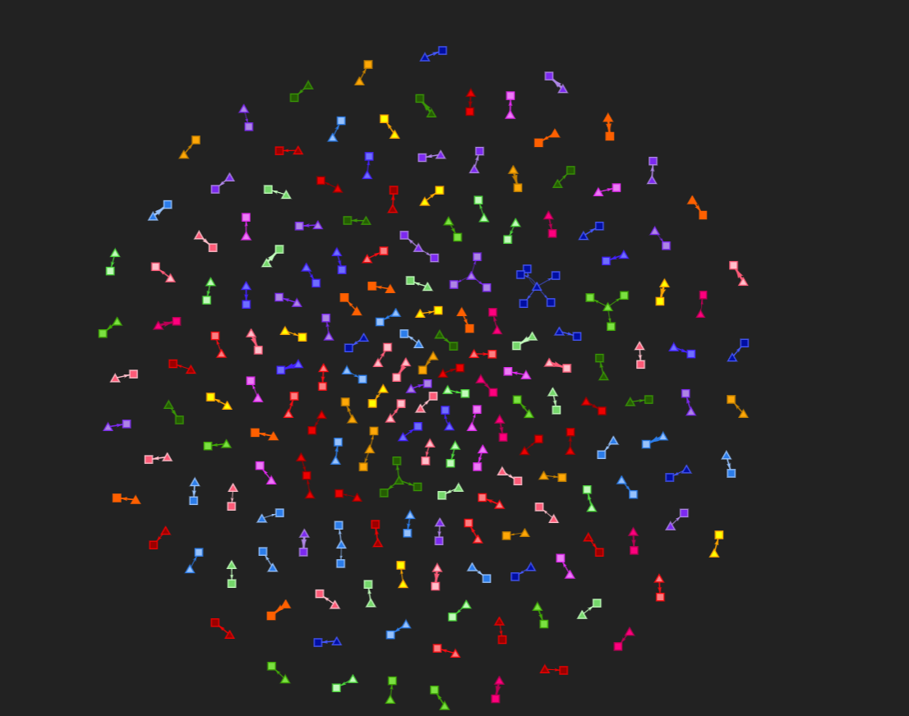

# Fraud Ring Detector 🕵️‍♂️📊

A hybrid deep learning pipeline built with Kedro and PyTorch Geometric to detect complex money-laundering syndicates and corporate financial fraud under leakage-aware evaluation.

## Executive Summary

- **End-to-End Pipeline:** Built with Kedro and PyTorch Geometric to score transactions for fraud and benchmark three progressively expressive architectures (`M1`, `M2`, and `M3`).
- **Relational Feature Lift:** Engineering graph-derived entity sharing and historical features (such as shared cards and devices per customer) increased gradient-boosting performance from **0.128 to 0.725 PR-AUC** on multi-pattern banking data.
- **Training-Budget Calibration:** Under the default 60-epoch full-batch budget (60 optimizer updates), the neural network (`M3`) underperformed the tree baseline (`0.646` vs. `0.725` PR-AUC). When trained for 300 epochs with an adjusted learning rate, `M3` matched the gradient-boosted baseline (**0.729 vs. 0.725 PR-AUC**) and recovered 95% of account-takeover cases.
- **Syndicate Detection Bounds:** At practical operational alert volumes (20–50 alerts per 10,000 transactions), flagged edges remain too sparse to form closed multi-hop laundering cycles.
- **Benchmark Scope:** All experiments are evaluated on synthetic benchmark datasets (Mendeley multi-pattern banking and IBM AMLworld) under strict chronological splits.

## Motivation & Methodology

This project investigates whether graph neural networks capture structural fraud patterns—particularly coordinated multi-account laundering syndicates—that tabular models miss.

The pipeline scores each transaction by combining:
- **GraphSAGE node embeddings** over accounts (customers, merchants, and shared cards/devices where available),
- **A 1D-CNN encoder** over each sender's recent transaction history, and
- **Transaction-level tabular features**.

Flagged transactions are then projected into a directed network to extract candidate syndicates via amount-weighted community detection, overlap analysis, flow-based role heuristics, and cycle enumeration. Every model is benchmarked against a progressive gradient-boosting ladder so architectural complexity is justified empirically.

All experiments follow strict leakage-prevention protocols:
- Chronological train/validation/test splits rather than random row splits,
- Exclusion of identifier and target-encoding columns from model inputs,
- **PR-AUC** and fixed-alert-volume recall rather than accuracy or ROC-AUC under severe class imbalance,
- Sender-clustered bootstrap confidence intervals, and
- Pre-modeling dataset profiling to verify structural signal before training.

> **Architectural Attribution:** Inspired by the hybrid GCN+CNN framework in Cai (2026), *Int. J. Comput. Intell. Syst.* 19:186. This repository implements an architectural extension rather than a direct replication (see *Differences from Cai (2026)* below).

## Architecture & Evaluation Ladder

Transactions are modeled as a heterogeneous graph in which customers, merchants, cards, and devices form nodes, and payment or entity-usage events form edges. Shared infrastructure (such as multiple customers transacting through a single card or device) exposes coordinated activity that appears benign at the single-transaction level.

Three models are evaluated on identical splits to isolate the contribution of each feature and modeling layer:

| Tier | Model | Description |
| :--- | :--- | :--- |
| **M1** | Gradient Boosting (Tabular Only) | Baseline trained strictly on individual transaction attributes |
| **M2** | Gradient Boosting + Relational Features | `M1` augmented with causal shared-entity and historical aggregation features |
| **M3** | Hybrid GraphSAGE + 1D-CNN | End-to-end neural architecture learning directly over the transaction/entity graph and sender sequences |

If **M3** does not outperform **M2**, learned graph message passing has not added predictive signal beyond explicit relational feature engineering.

## Two Evaluation Tracks

| Dimension | Track B: Fraud Scoring (Banking Dataset) | Track A: Ring Detection (Three AMLworld Windows) |
| :--- | :--- | :--- |
| **Research Question** | Does graph structure add lift beyond strong relational tabular features? | Can graph models recover named multi-hop laundering topologies? |
| **Dataset** | Mendeley-style banking dataset (customers, merchants, cards, devices) | IBM AMLworld (`HI-Small`: account-to-account transfers + ground-truth pattern file) |
| **Fraud Typologies** | Card testing, geographic anomalies, account takeover, laundering rings | Fan-in/out, cycles, scatter-gather, gather-scatter, bipartite, stack, random |
| **Evaluation Protocol** | Baseline ladder + recall per fraud typology | Baseline ladder + pattern-level recall + sender-clustered bootstrap intervals |
| **Execution Command** | `kedro run --env mendeley` | `kedro run --env amlworld` |

## What Track B Showed (v0.4.1, Mendeley-Style Data)

**Experimental Setup:** 310,906 transactions (~31% of non-fraudulent rows, retaining every fraudulent customer's complete transaction history), evaluated on a strict time-held-out test split with population sampling correction applied (true population fraud rate: `0.149%`).

| Model | PR-AUC (95% Interval) | Recall | Precision in the Real Population\* | Alerts per 10,000 |
| :--- | :--- | :--- | :--- | :--- |
| M1 GradBoost, tabular only | 0.128 (0.097 to 0.161) | 0.44 | 4.1% | 162 |
| M2 GradBoost + graph/sequence features | **0.725 (0.668 to 0.784)** | 0.72 | 93.0% | 11.5 |
| M3 Hybrid GraphSAGE+CNN (+card/device nodes) | 0.646 (0.590 to 0.705) | 0.58 | 62.7% | 13.8 |

\*Corrected for negative downsampling; approximate because the sample retains complete histories for all fraudulent customers.

### Track B Syndicate & Fraud Rings Dashboard



In operational terms, **M1** generates approximately 162 alerts per 10,000 transactions at 4.1% precision, whereas **M2** generates 11.5 alerts per 10,000 transactions at 93.0% precision.

A paired bootstrap over sender accounts (200 resamples) yields **M2 minus M1 = +0.60 (0.54 to 0.65)** and **M3 minus M2 = -0.081 (-0.118 to -0.052)**, with 0 of 200 resamples favoring `M3` under the default training budget. Note that this interval captures test-set sampling variance rather than seed initialization variance or temporal drift; an earlier 3-seed initialization run produced PR-AUC scores of `0.124` (`M1`), `0.723` (`M2`), and `0.656` (`M3`).

**Recall by Fraud Typology** (test period; $n$ = transactions):

| Fraud Type | $n$ | M1 | M2 | M3 |
| :--- | :--- | :--- | :--- | :--- |
| `card_testing` | 143 | 0.72 | 1.00 | 1.00 |
| `geo_anomaly` | 76 | 0.01 | 0.00 | 0.00 |
| `account_takeover` | 40 | 0.00 | 0.95 | 0.00 |
| `money_laundering_ring` | 19 | 1.00 | 0.95 | 1.00 |

### Key Findings from Track B

1. **Shared infrastructure drives predictive performance:** Removing card and device entities drops `M2` PR-AUC from `0.725` to `0.201`, reduces account-takeover recall from `0.95` to `0.00`, and lowers card-testing recall from `1.00` to `0.45`. Nearly all of `M2`'s gain comes from causal relational counts (shared customers per card/device and distinct devices per customer).
2. **Training-budget calibration resolves M3's deficit:** Under the default budget (60 full-batch epochs, equating to 60 gradient updates), `M3` scored `0.646` and failed to learn account-takeover patterns. Training the same network for 300 epochs with a larger learning rate and no neighbor message passing increased PR-AUC to **0.729 (0.671 to 0.785)** against `M2`'s **0.725 (0.668 to 0.784)**—a delta of **+0.003 (0.001 to 0.007)**—while raising account-takeover recall from `0.00` to `0.95`.
3. **Message passing vs. engineered relational features:** Both `M2` and `M3` receive the explicit relational features. At the default budget, GraphSAGE (`0.646`) and no-message-passing (`0.656`) differed within run-to-run initialization variance (`0.009`). Whether learned message passing adds incremental lift once fully trained is queued for evaluation via `kedro run --env longtrain`.
4. **Recall at fixed alert volumes:** Under default training, `M3` matched `M2` only at the top of the ranking: at 5 alerts per 10,000, `M2` and `M3` capture 34% and 32% of fraud respectively; at 20 per 10,000, they capture 72% and 63% (compared to 13% for `M1`). With adequate training epochs, `M3`'s recall matches `M2` across all evaluated operating points.
5. **Geographic anomalies remain uncaptured:** None of the three models detect `geo_anomaly` events (27% of test positives), indicating a feature-representation gap requiring targeted error analysis.
6. **Limited ring sample size in Track B:** Only 19 test transactions belong to `money_laundering_ring`, and `M1` detects all of them via tabular signals alone—motivating Track A for structural ring evaluation.
7. **Leakage verification:** An initial profiler run yielded `0.965` PR-AUC for a plain tabular model due to `transaction_id` leakage. Removing identifier columns established the true `0.128` tabular baseline.

### Ablation & Training-Budget Studies

Each ablation is configured as an isolated Kedro environment with dedicated output artifacts:

```bash
kedro run --env ablation_no_entities    # Excludes card/device nodes and shared-entity counts
kedro run --env ablation_no_graph       # M3 inputs without GraphSAGE neighbor aggregation (60 epochs)
kedro run --env longtrain_no_graph      # No message passing, 300 epochs, larger learning rate (~15–20 min)
kedro run --env longtrain               # Full GraphSAGE message passing, 150 epochs (~30 min)
```

| Variant | M2 PR-AUC | M3 PR-AUC | Account Takeover Recall (M2 / M3) | Card Testing Recall (M2 / M3) |
| :--- | :--- | :--- | :--- | :--- |
| Full, default training (`--env mendeley`) | 0.725 (0.668 to 0.784) | 0.646 (0.590 to 0.705) | 0.95 / 0.00 | 1.00 / 1.00 |
| No entities | 0.201 (0.156 to 0.245) | 0.111 (0.072 to 0.150) | 0.00 / 0.00 | 0.45 / 0.01 |
| No message passing, default training | 0.725 (same model) | 0.656 (0.601 to 0.714) | 0.95 / 0.00 | 1.00 / 1.00 |
| **No message passing, long training** | 0.725 (same model) | **0.729 (0.671 to 0.785)** | 0.95 / **0.95** | 1.00 / 1.00 |

`M1` (tabular baseline) remains invariant at `0.128` across all variants. Confidence intervals reflect 200 sender-clustered bootstrap resamples on the test split.

**Next Steps:** Execute `kedro run --env longtrain` and `python tools/run_all.py ... --aml-env amlworld_longtrain` to test message passing under adequate training budgets; perform error analysis on `geo_anomaly` transactions; evaluate leakage-free model stacking (`M2` + out-of-fold `M3` scores); and validate across multiple temporal splits.

## What Track A Showed (IBM AMLworld HI-Small, Three Valid Windows)

Because IBM AMLworld (`HI-Small`) contains roughly 5 million transactions, experiments on an 8 GB RAM workstation use contiguous **time windows** of ~300,000–320,000 transactions with an internal 60/20/20 chronological split, preserving local graph density and account transaction histories.

| Window | Selection Method | Hours | Transactions | Laundering Rows | Laundering in Test Period |
| :--- | :--- | :--- | :--- | :--- | :--- |
| `time 0.3` | Clock | 127 to 143 | 311,621 | 395 (0.13%) | 42 |
| `time 0.5` | Clock | 212 to 239 | 306,128 | 504 (0.16%) | 132 |
| `rows 0.85` | Transaction count | 195 to 207 | 320,099 | 267 (0.08%) | 47 |

A fourth window (`time 0.7`) was **excluded as degenerate**: transaction volume drops sharply after hour 297, leaving 374 rows with a 59% laundering rate where all models trivially achieved `1.000` PR-AUC. The pipeline tooling now automatically rejects degenerate windows. Additionally, roughly 40% of laundering transactions in the dataset are unlisted in `HI-Small_Patterns.txt`—a property of the source dataset rather than a parsing discrepancy.

**PR-AUC with 95% Sender-Clustered Bootstrap Intervals:**

| Window | M1 Tabular | M2 + Graph/Flow Features | M3 Hybrid GraphSAGE+CNN | M3 minus M2 |
| :--- | :--- | :--- | :--- | :--- |
| `time 0.3` | 0.016 (0.008 to 0.029) | **0.133 (0.061 to 0.294)** | 0.052 (0.021 to 0.140) | -0.088 (-0.178 to -0.003) |
| `time 0.5` | 0.045 (0.032 to 0.059) | **0.151 (0.095 to 0.220)** | 0.036 (0.019 to 0.065) | -0.114 (-0.177 to -0.064) |
| `rows 0.85` | 0.034 (0.013 to 0.114) | **0.070 (0.030 to 0.167)** | 0.001 (0.001 to 0.001)\* | -0.079 (-0.166 to -0.029) |

\*`M3` failed to converge in `rows 0.85`: best validation PR-AUC occurred at epoch 1, triggering early stopping at epoch 11 (test ROC-AUC: `0.44`).

**Recall and Precision at Fixed Alert Volumes** (top-ranked transactions capped at 20 or 50 alerts per 10,000):

| Window | Recall at 20 (M1 / M2 / M3) | Recall at 50 (M1 / M2 / M3) | True Positive Share at 20 (M1 / M2 / M3) |
| :--- | :--- | :--- | :--- |
| `time 0.3` | 0.07 / **0.36** / 0.17 | 0.14 / **0.45** / 0.24 | 5% / **23%** / 11% |
| `time 0.5` | 0.06 / **0.24** / 0.08 | 0.17 / **0.31** / 0.18 | 5% / **20%** / 6% |
| `rows 0.85` | 0.11 / **0.19** / 0.00 | 0.21 / **0.28** / 0.00 | 5% / **8%** / 0% |

### Key Findings from Track A

1. **Relational flow features outperform across all windows:** `M2` achieves the highest recall at equal alert volume in every window, detecting $3.3\times$ as much laundering on average as `M1` at 20 alerts per 10,000 (26% vs. 8%), with bootstrap intervals excluding zero against `M1` in two of three windows.
2. **M3 results reflect a constrained training budget:** Full-batch training for 60 epochs provides only 60 gradient updates, and `M3` stalled completely on `rows 0.85`. Given Track B's training-budget findings, `M3`'s Track A scores represent undertrained-budget performance rather than an upper bound on graph neural networks (`conf/amlworld_longtrain` provides the extended-training configuration).
3. **Low absolute precision at scale:** At 20 alerts per 10,000, roughly 1 in 5 alerts is a true positive in the stronger windows (`time 0.3`, `time 0.5`) and 1 in 12 in `rows 0.85`.
4. **Unlisted laundering transactions:** At 20 alerts per 10,000, `M2` recovers 22%, 9%, and 11% of laundering rows omitted from `HI-Small_Patterns.txt`, while `M1` and `M3` recover $\le 6\%$.
5. **Pre-registered pattern sample thresholds:** Test splits contain 1, 16, and 2 listed pattern instances respectively, falling below the pre-registered threshold of 5 instances per pattern typology required for non-anecdotal pattern claims.
6. **Sparse flagged subgraphs prevent cycle recovery:** Constructing the syndicate graph from `M2`'s top-flagged edges (23–35% true laundering precision) yields isolated account pairs with zero closed cycles or connected components of $\ge 3$ accounts in any window. At practical alert budgets, flagged subgraphs are too sparse to reconstruct complete rings.

Decision rules were pre-registered prior to executing Track A (`docs/TRACK_A_PLAN.md`): `M2` outperformed `M3` with bootstrap intervals below zero across all three windows (Rule 2, qualified by training-budget limits); pattern-level counts remain anecdotal (Rule 3); three valid windows were completed (Rule 4); and no syndicate-detection claim is made (Rule 5).

## Differences from Cai (2026)

While inspired by the hybrid GCN+CNN architecture proposed in Cai (2026), this implementation differs across every core component:

- **Model Architecture:** Uses inductive GraphSAGE (`SAGEConv`) rather than transductive GCN, paired with a 1D-CNN over each sender's chronological last-$K$ transaction sequence rather than reshaped single-transaction feature vectors.
- **Datasets:** Evaluated on a multi-pattern banking dataset and IBM AMLworld rather than PaySim alone, where graph structure is overly sparse.
- **Evaluation Protocol:** Uses strict temporal splits, PR-AUC, fixed-alert-volume recall, sender-clustered bootstrap intervals, systematic ablations, and training-budget diagnostics instead of accuracy on random splits.
- **Baselines:** Benchmarks against a custom progressive ladder incorporating causal relational and flow aggregations (`M2`).
- **Empirical Conclusions:** Demonstrates that explicit relational features drive the primary gains, whereas learned message passing shows no confirmed lift over `M2` and sparse alert budgets limit cycle reconstruction.
- **Non-Comparable Headline Metrics:** Reported figures in Cai (2026) were generated on different data splits and metrics and contain internal numerical inconsistencies; the paper is treated strictly as architectural inspiration.

## Status & Limitations

- **Evaluation Coverage:** Track B has been evaluated via 3-seed initialization, sender-clustered bootstrapping, and four ablations on a single temporal split. Track A has been evaluated across three valid AMLworld windows (with one degenerate window excluded).
- **Synthetic Benchmarks:** Results reflect structural properties of synthetic generators rather than production banking traffic.
- **Cycle Recall Ceiling:** Recovering a $k$-hop cycle requires flagging all $k$ constituent edges, bounding cycle recall by edge-level model recall.
- **Sampling Trade-offs:** Uniform row sampling degrades account histories; customer-level sampling (`--customer-frac` in Track B) and contiguous time windows (Track A) are used to preserve graph integrity.
- **Multi-Currency Normalization:** IBM AMLworld transactions span multiple currencies without FX conversion rates, making raw transaction amounts approximate across currencies.

---

# Technical Reference

## Pipeline (Kedro DAG)

| Node | Responsibility |
| :--- | :--- |
| `prepare_dataset_node` | Retains all fraud rows, caps negative rows, sorts chronologically, creates **time-based** train/val/test splits, and builds shared entity indices |
| `build_features_node` | Extracts tabular features, causal shared-entity counts, optional account-flow features, per-split graph snapshots, and last-$K$ sequence tensors |
| `train_baselines_node` | Trains `M1` (tabular) and `M2` (tabular + relational/sequence features) gradient-boosted models |
| `train_hybrid_model_node` | Trains full-batch bidirectional GraphSAGE + 1D-CNN with focal loss and early stopping on validation PR-AUC |
| `evaluation_node` | Computes PR-AUC, ROC-AUC, P/R/F1, population-adjusted precision, alerts/10k, per-typology recall, bootstrap intervals, and threshold sweeps |
| `pattern_evaluation_node` | Track A: computes recall per laundering pattern typology and instance (`detected-any` / `detected-majority`) |
| `syndicate_analysis_node` | Extracts directed, amount-weighted Louvain communities, overlap, role heuristics, and cycles on flagged edges; exports tables and PyVis dashboard |
| `neo4j_sync_node` | Optional: syncs flagged transactions to Neo4j AuraDB via environment variables |

## Project Layout

```text
conf/base/            catalog.yml, parameters.yml (hyperparameters and thresholds)
conf/mendeley/        Track B environment overrides (`kedro run --env mendeley`)
conf/amlworld/        Track A environment overrides (`kedro run --env amlworld`)
conf/ablation_*/      Track B ablations (no entities, no message passing)
conf/longtrain*/      Extended training-budget configurations
data/01_raw ...       Git-ignored data directories (tracked via .gitkeep); outputs land in data/07_model_output/<env>/
src/fraud_ring_detector/
    pipeline_registry.py, settings.py, synthetic.py, amlworld.py
    pipelines/fraud_detection/{nodes.py, model.py, topology.py, pipeline.py}
docs/TRACK_A_PLAN.md   Pre-registered Track A evaluation plan and decision rules
notebooks/             Standalone exploratory walkthrough
tests/                 26 unit and smoke tests covering splits, causality, adapters, patterns, windows, and evaluation
tools/                 run_all.py, run_seeds.py, check_text_overlap.py, check_id_columns.py, check_pattern_match.py
filter_data.py         Dataset sampling and schema adapters (paysim / banking / amlworld)
profile_dataset.py     Pre-modeling dataset triage and leakage profiler
```

## Data

| Dataset | Track | Role | Output Path from `filter_data.py` |
| :--- | :--- | :--- | :--- |
| Mendeley multi-pattern banking dataset | B | Primary fraud-scoring benchmark | `data/01_raw/banking_sample.csv` |
| IBM AMLworld `HI-Small` + `HI-Small_Patterns.txt` | A | Primary ring-detection benchmark | `data/01_raw/amlworld_sample.csv` |
| Built-in synthetic generators (`--synthetic*`) | All | Fast pipeline smoke tests | Schema-specific sample path |
| PaySim (Kaggle) | Legacy | Supported (balance columns carry leakage risk) | `data/01_raw/paysim_sample.csv` |

Each dataset writes to an isolated sample file and output directory to prevent cross-run overwrites. Profile any dataset prior to training:

```bash
python profile_dataset.py "data/01_raw/<file>.csv" --nrows 0
python tools/check_id_columns.py "data/01_raw/<file>.csv" ip_address card_id device_id --entity customer_id
```

Target-encoding metadata columns (`fraud_type`, `pattern_type`, `pattern_id`) are restricted strictly to post-hoc evaluation and excluded from feature matrices.

## Run It

```bash
python -m venv venv && source venv/bin/activate        # Windows: .\venv\Scripts\Activate.ps1
pip install -r requirements.txt
pytest -q                                                # Set PYTHONPATH=src first

# 1-minute smoke tests with synthetic mock data
python filter_data.py --synthetic-banking && kedro run --env mendeley
python filter_data.py --synthetic-aml     && kedro run --env amlworld

# Track B on real data (8 GB RAM: retain full histories for a customer subset)
python filter_data.py --input "data/01_raw/Fraud_Detection_Dataset.csv" --customer-frac 0.3
# -> negative_sampling_fraction (0.3099) is pre-configured in conf/mendeley/parameters.yml
kedro run --env mendeley
python tools/run_seeds.py --seeds 1 2 3 --env mendeley

# Track A on real data (contiguous time window preserves graph density and fraud prevalence)
python filter_data.py --input "data/01_raw/HI-Small_Trans.csv" --window-start 0.5 --window-rows 300000
kedro run --env amlworld
```

**Memory Footprint (CPU benchmark):** 100k rows $\approx$ 1.1 GB peak RAM; 300k rows $\approx$ 2.3 GB peak RAM; 1M rows $\approx$ 6 GB peak RAM.  
Outputs are written to `data/07_model_output/<env>/` (`metrics.json`, `threshold_sweep.csv`, `syndicates.csv`, `account_roles.csv`, `pattern_recall.csv`, `fraud_rings_dashboard.html`), with multi-seed summaries in `data/08_reporting/<env>/`.

### End-to-End Batch Execution

```bash
python tools/run_all.py --aml-input "data/01_raw/HI-Small_Trans.csv" --windows 0.3 0.5 --row-windows 0.85
```

Builds each AMLworld window, runs the pipeline, archives artifacts, optionally re-runs Track B, and writes `data/08_reporting/final/final_summary.md` alongside a single consolidated bundle at `data/08_reporting/results_bundle.zip`. Execution is resumable (completed windows are skipped unless `--force` is passed), and individual window failures are logged without aborting the batch.

## Syndicate Analysis (Scope & Heuristics)

- **Graph Construction & Clustering:** Merged directed graph (edge weights summed per account pair) clustered via directed, amount-weighted Louvain community detection.
- **Community Overlap:** Edge-based partitioning; accounts spanning multiple communities are logged in `account_roles.csv`.
- **Flow Role Heuristics:** Classifies accounts as `originator`, `mule`, `collector`, or `mixed` from in-flow/out-flow ratios (heuristic indicators, not ground-truth labels).
- **Structural Motifs:** Enumerates directed cycles up to `max_cycle_len` hops alongside fan-in, fan-out, and gather-scatter hubs.
- **Current Exclusions:** Temporal hop ordering, cross-institution visibility, supervised role classification, and shared device/IP edges between flagged customers.

## Optional: Neo4j AuraDB

Set `neo4j.enabled: true` in `parameters.yml` and export `NEO4J_URI`, `NEO4J_USERNAME`, and `NEO4J_PASSWORD` (for AuraDB instances, username and database match the instance ID). Never commit credentials (see `.env.example`).

## Originality & Verification

All source code and documentation are original; Cai (2026) is cited strictly as architectural inspiration. `tools/check_text_overlap.py` audits the repository against source texts for verbatim overlap.

## Tech Stack

Kedro, PyTorch, PyTorch Geometric (`SAGEConv`), scikit-learn, NetworkX (Louvain), PyVis, Neo4j (optional).